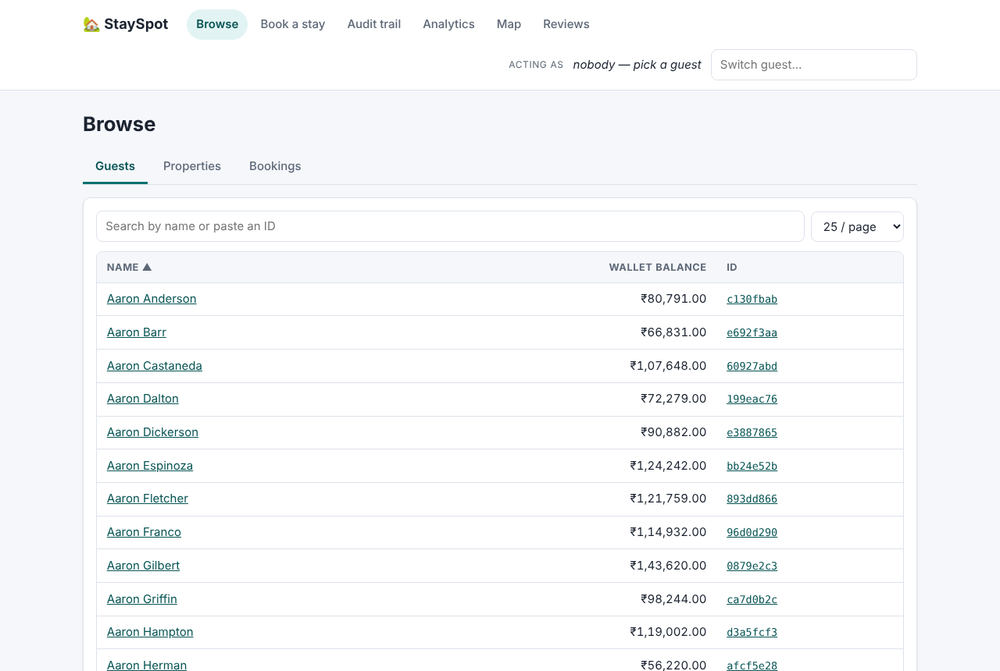
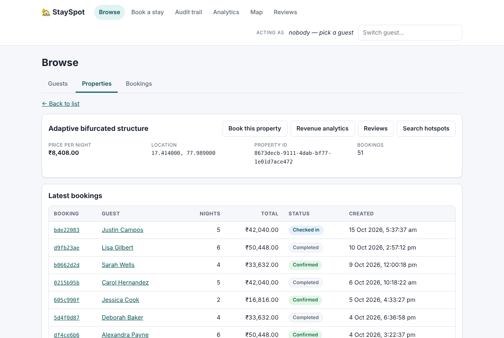
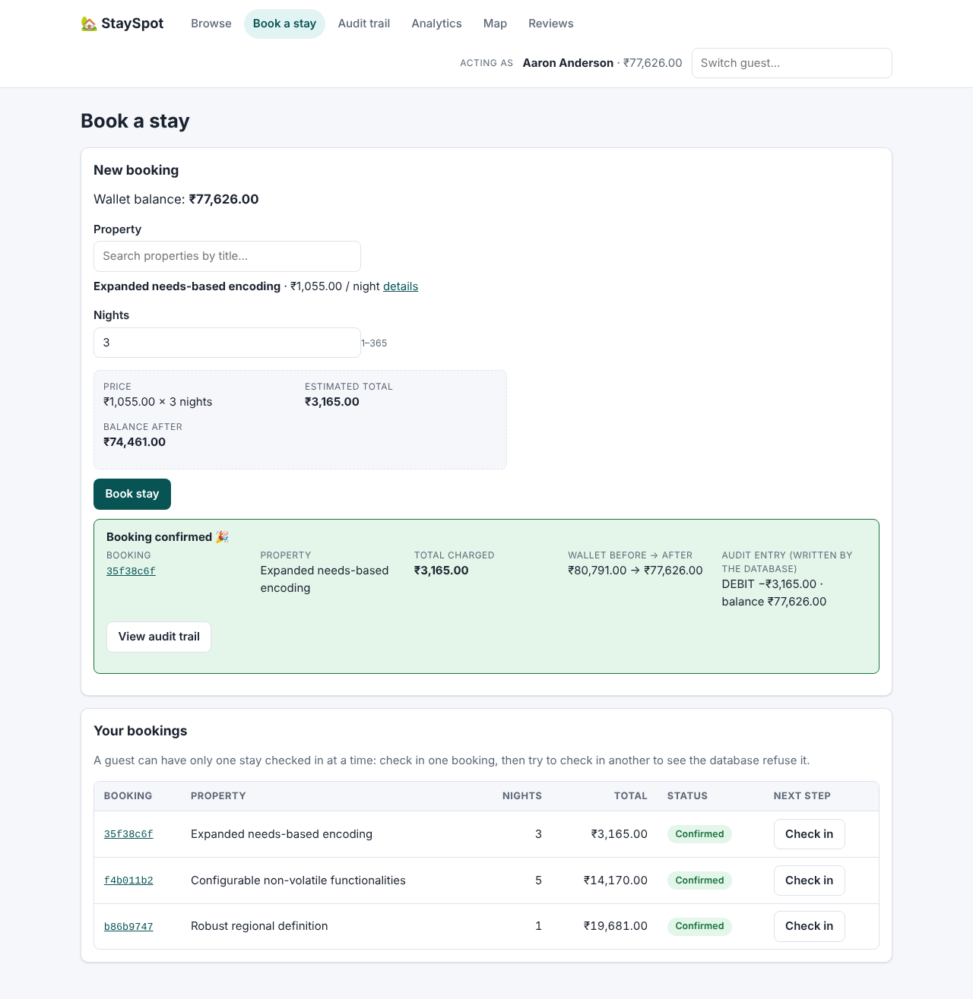
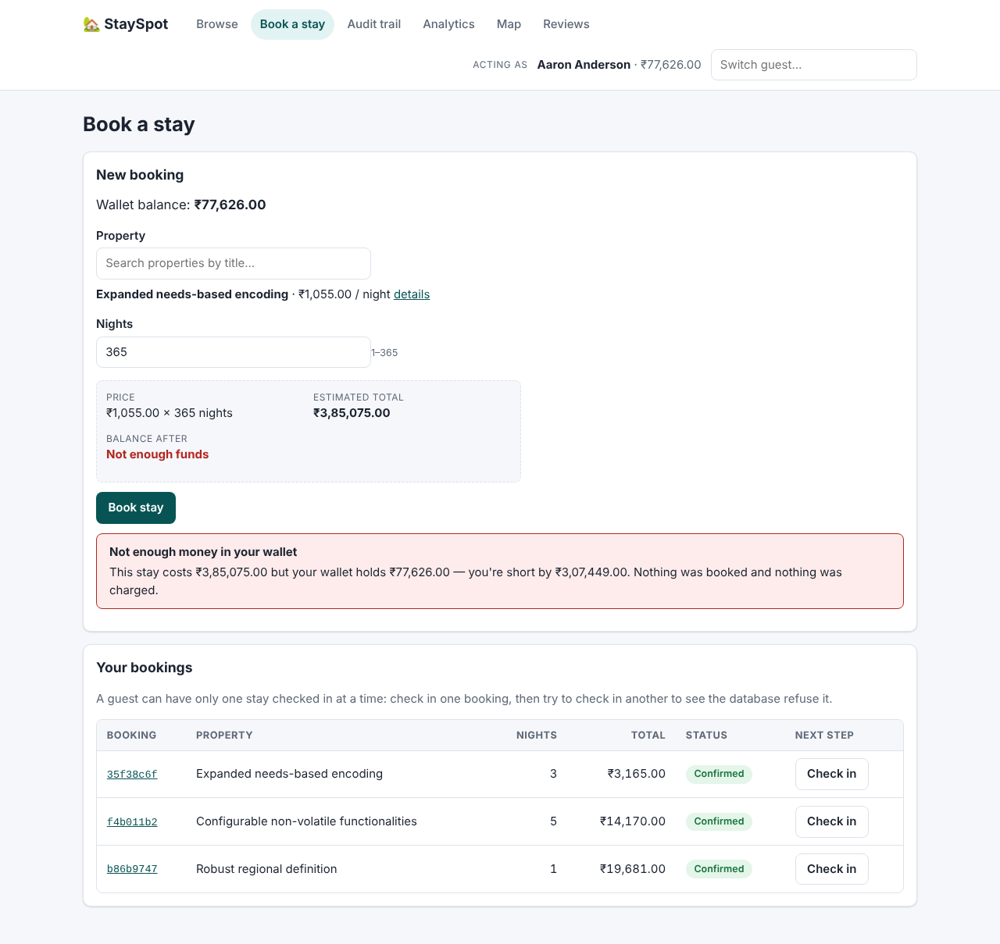
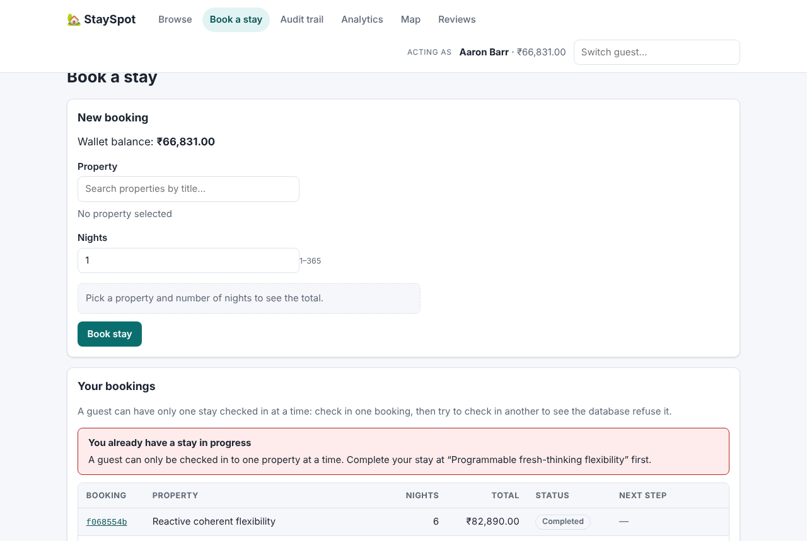
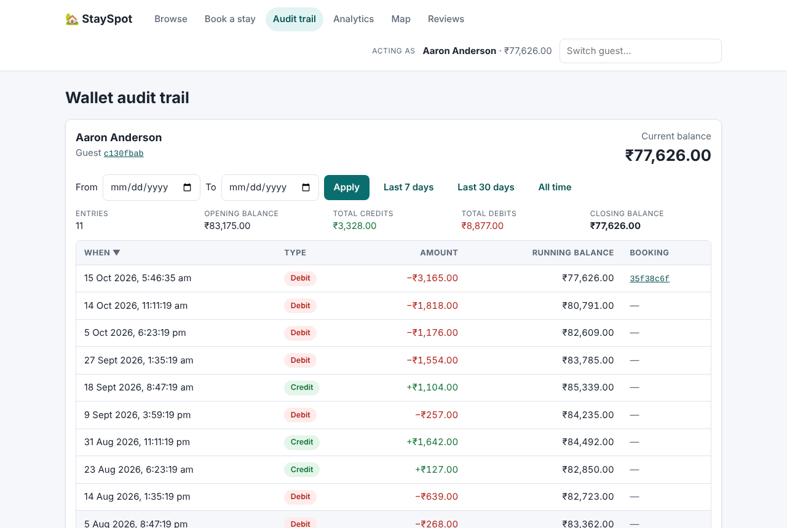
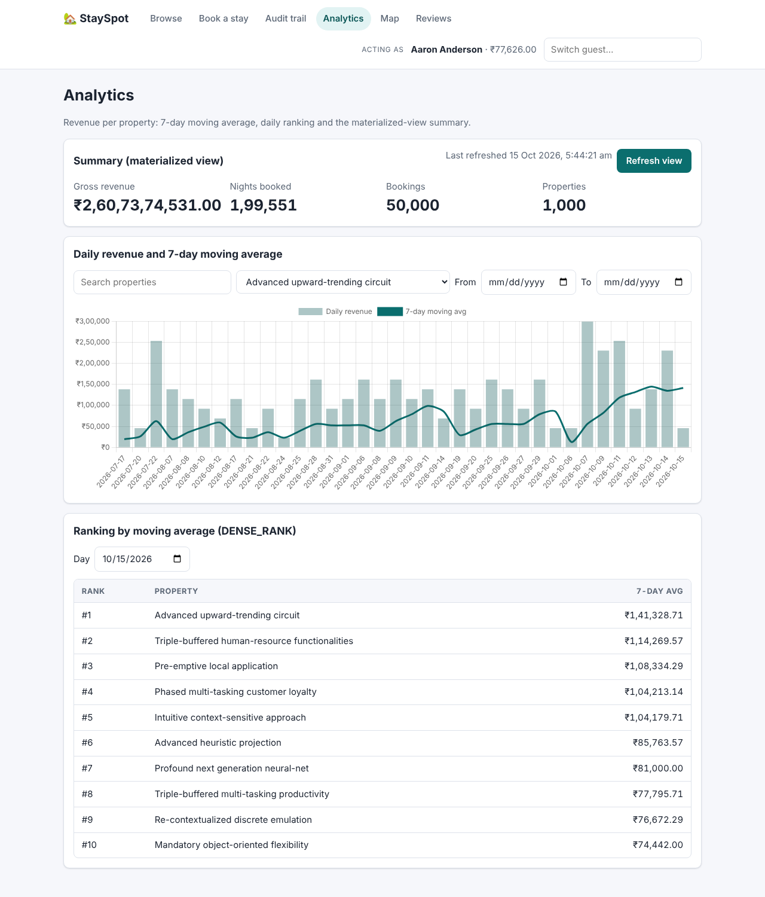
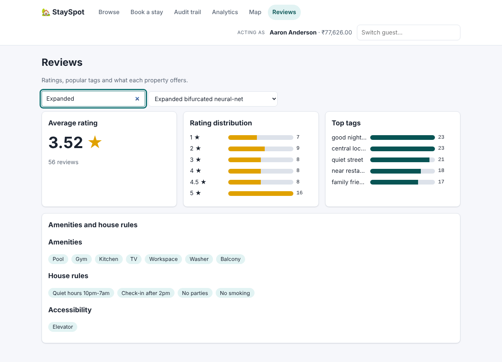
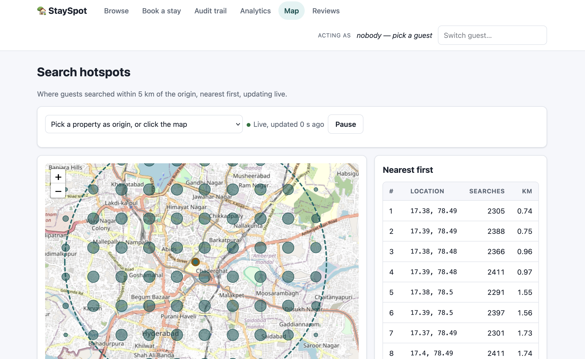
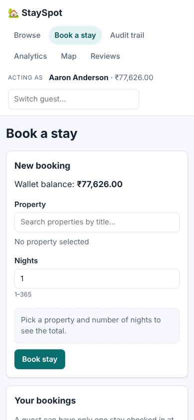

# StaySpot: Vacation Rental Experiences

A web front end and API for the StaySpot Part A databases. Guests browse properties, book stays paid from a wallet, check in and out, and see their wallet audit trail. Hosts see revenue analytics, a live map of search hotspots and review statistics.

- **PostgreSQL** holds guests, properties, bookings, wallets and the wallet audit log. Every business rule (price, balance check, locking, audit row, status changes) runs inside PostgreSQL procedures and triggers.
- **MongoDB** holds the flexible documents: `PropertyAmenities`, `PropertyReviews` and `SearchSessions` (geospatial pings).

## Repository information

**GitHub repository:** https://github.com/Avanishx05/StaySpot-Vacation-Rental-Experiences-1b
(forked from the Assignment 1 repository https://github.com/SaiSrinivas49/-StaySpot-Vacation-Rental-Experiences, with its commit history kept)

**Final commit hash:** `REPLACE_WITH_FINAL_HASH`

## Contents

| Path | What it is |
|---|---|
| `sql/01`-`05` | Schema, indexes, audit trigger and guards, stored procedures, materialized view |
| `sql/06_window_analytics.sql` | Workflow 2 query (7-day moving average + `DENSE_RANK`) |
| `mongo/01`-`03` | Mongo collections and indexes, Workflow 3 (`$geoNear`), Workflow 4 (`$facet`) |
| `data_generation/` | PostgreSQL and MongoDB seeders |
| `api/` | Express API (`api/src`), API tests (`api/test`) |
| `web/` | React front end (`web/src`), front-end tests (`web/test`) |
| `docs/handover_note.md` | Step 1: handover note on the inherited Part A |
| `docs/api_endpoints.md` | API reference (every endpoint, input, output, database, error codes) |
| `docs/design/` | Step 2: users, wireframes (`wireframes/`), style guide, design system |
| `docs/screens_3_1_to_3_3.md`, `docs/screens_3_4_to_3_6.md` | Per-screen notes, edge cases and a demo script |
| `docs/step4_test_plan.md` | Step 4 test plan |
| `performance/` | EXPLAIN ANALYZE output and the Mongo execution-stats script |

## How to run

### Prerequisites
- Node.js 20 or newer and npm
- PostgreSQL 14 or newer (with the `uuid-ossp` and `pg_trgm` contrib extensions), and a role that can create databases
- MongoDB 6 or newer (only the Map and Reviews screens need it)
- Python 3.10 or newer
- Internet access in the browser for the OpenStreetMap tiles on the Map screen

### 1. Configure
From the repository root:

```bash
cp .env.example .env
```

Edit `.env` if your services differ from the defaults: `PG_HOST=localhost`, `PG_PORT=5432`, `PG_DB=stayspot`, `PG_USER=postgres`, `PG_PASSWORD=postgres`, `MONGODB_URI=mongodb://localhost:27017`, `MONGODB_DB_NAME=stayspot`, `API_PORT=4000`. The seeders, Mongo scripts and API all read this file.

### 2. Create and seed PostgreSQL

```bash
createdb stayspot
for f in sql/0[1-5]*.sql; do psql -d stayspot -v ON_ERROR_STOP=1 -f "$f" || break; done
python3 -m venv .venv
. .venv/bin/activate
pip install -r data_generation/requirements.txt
python data_generation/postgres_seeder.py
```

The seeder takes about 40 seconds and creates 10,000 guests, 1,000 properties, 50,000 bookings spread over the last 90 days and 100,000 wallet updates (each one audited by the trigger), then refreshes the materialized view. `sql/06_window_analytics.sql` is the Workflow 2 query; run it on its own with `psql -d stayspot -f sql/06_window_analytics.sql`.

To start over: `dropdb stayspot && createdb stayspot` and repeat. The audit table is append-only, so it cannot be truncated.

### 3. Seed MongoDB

```bash
npm install                          # repo root: dotenv + mongodb for the scripts and the map route
python data_generation/mongo_seeder.py
npm run mongo:setup                  # collections, 2dsphere and TTL indexes
npm run mongo:workflow3              # Workflow 3: trending hotspots ($geoNear)
npm run mongo:workflow4              # Workflow 4: review analytics ($facet)
```

The Mongo seeder uses the PostgreSQL property and guest ids, so run it after the PostgreSQL seeder. Seeded search sessions are stamped within the last 2 hours and the TTL index deletes them after 2 hours, so **re-run `mongo_seeder.py` shortly before using the Map screen**.

### 4. Build and start the app

```bash
cd web && npm install && npm run build      # React front end -> web/dist
cd ../api && npm install && npm start       # API + built front end
```

Open **http://localhost:4000**. The API serves the built front end and all endpoints under `/api`.

For front-end development, keep the API running and in a second terminal run `cd web && npm run dev`. Vite serves http://localhost:5173 with hot reload and forwards `/api` to port 4000.

### 5. Run the tests

```bash
cd api && npm test      # node:test + Supertest against a real PostgreSQL
cd ../web && npm test   # Vitest + React Testing Library (no databases needed)
```

The API suite **drops and recreates** a throw-away database called `stayspot_test` (change it with `TEST_PG_DB`), applies `sql/01`-`05` and tests the real procedures, triggers and indexes. Never point `TEST_PG_DB` at a database you need. Mongo routes are tested against an in-memory fake, so MongoDB is not needed for the tests. The scenarios are listed in `docs/step4_test_plan.md`.

### Troubleshooting
- `psql -d stayspot -c '\dt'` should list `guests`, `properties`, `bookings`, `wallet_audit_logs` and `mv_refresh_log`.
- `mongosh "$MONGODB_URI"` should connect.
- If the API cannot reach a database, check the values in `.env`.
- When MongoDB is not running, Map and Reviews show an error ("Search and review data is temporarily unavailable") and the other screens keep working.

## Screens

| Screen | What it does |
|---|---|
| **Browse** | Guests, properties and bookings with search, sorting, filters and paging; a detail page per record |
| **Actor switcher** ("Acting as" in the header) | Pick the guest you are acting as; shows their wallet balance; remembered in the browser |
| **Book a stay** | Pick a property and nights; shows the price, the wallet balance before and after, and the audit row the trigger wrote. "Your bookings" moves a booking from Confirmed to Checked in to Completed |
| **Audit trail** | The acting guest's wallet history with a date filter, running balance, totals and links to bookings |
| **Analytics** | Daily revenue and 7-day moving average per property, the daily `DENSE_RANK` ranking, and the materialized-view summary with a "Refresh view" button |
| **Map** | Search hotspots within 5 km of an origin (`$geoNear`), polled every 4 seconds, nearest first |
| **Reviews** | Average rating, rating distribution and top tags (`$facet`), plus the property's amenities, house rules and accessibility features |

Every screen has loading, empty and error states and works at phone width.

### Demo walkthrough (works with any seeded guest)
1. **Successful booking:** pick a guest under "Acting as", open Book a stay, choose a property and 3 nights, and book. The result shows the wallet before and after and the DEBIT audit row linked to the booking.
2. **Not enough balance:** same guest, any property, **365 nights**. A year's stay always costs more than a seeded wallet holds (at least ₹3,65,000 against a seeded maximum of about ₹1,70,000), so the booking is refused, nothing is charged and the balance is unchanged.
3. **Blocked second check-in:** under "Your bookings", check in one booking, then try to check in another. The partial unique index `idx_active_stay` refuses the second one. Complete the first stay, and the second check-in works. About 64% of seeded guests already have a checked-in booking, so for them the first check-in is already refused.
4. **Audit trail:** the booking just made is the newest DEBIT row. Older rows without a booking are the seeder's wallet changes.

More detail and edge cases: `docs/screens_3_1_to_3_3.md` and `docs/screens_3_4_to_3_6.md`.

## Screenshots

Taken from a freshly seeded database on 15 Oct 2026.

| | |
|---|---|
| Browse  | Property detail  |
| Booking succeeded  | Not enough balance  |
| Second check-in blocked  | Audit trail  |
| Analytics  | Reviews  |
| Map  | Phone  |

## Demo video

**Demo video (5 minutes or less): https://drive.google.com/file/d/1d8pwJvabjVTS6G-Dn4gDo2uvqysLROBW/view?usp=sharing**

## Tech choices
- **Front end: React 18 + Vite + React Router (`HashRouter`).** Function components and hooks; state that belongs in the URL (filters, sort, page, selected property) lives in the URL, and the acting guest lives in a React context. `npm run build` writes `web/dist`, which the API serves.
- **Charts: Chart.js 4** for the revenue bars and moving-average line. **Map: Leaflet 1.9 with OpenStreetMap tiles.** Both are npm dependencies bundled by Vite, created when a screen mounts and destroyed when it unmounts.
- **API: Node + Express + `pg`, plus the `mongodb` driver for Map and Reviews.** A thin layer: it validates input, runs the transaction and turns database errors into clear HTTP errors (`docs/api_endpoints.md`). The Map route reuses the Workflow 3 pipeline from `mongo/02_workflow3_geonear.js`, and Reviews reuses the Workflow 4 `$facet` pipeline.
- **Design:** users and wireframes are in `docs/design/` (Step 2). The built app takes its colours, type and components from `docs/design/design_system.md` (teal palette) rather than the pine and mint palette first proposed in `docs/design/style_guide.md`.

## Assumptions

### Data and database
- A guest can have at most one CHECKED_IN booking at a time, enforced by the partial unique index `idx_active_stay`.
- A booking's price is always `properties.base_price × nights`, taken from the database; `nights` is 1 to 365. We added the `bookings.nights` column to the spec schema to record the length of the stay.
- Every wallet change is written to `wallet_audit_logs` by a trigger. The audit table is append-only: UPDATE, DELETE, TRUNCATE and direct INSERT are rejected. A PostgreSQL superuser could bypass this with `session_replication_role`, so the API should connect as a normal role.
- Workflow 2's moving average is a **7-calendar-day window** (`RANGE BETWEEN INTERVAL '6 days' PRECEDING AND CURRENT ROW`, divided by 7), so days without bookings count as zero. The ranking is per day with `DENSE_RANK()`, so ties share a rank.
- "Day" means `date(created_at)` in the database session's time zone.
- Seeded bookings do not debit wallets, so only bookings made through the app create booking-linked audit rows.
- MongoDB documents store the PostgreSQL UUIDs as strings in `property_id` and `guest_id`, so the two databases join on the same ids.
- Data is synthetic (Faker) and is only for testing and demonstrating.

### App
- Money is shown as INR (₹) and kept as decimal strings end to end, never floats.
- "Acting as" is a demo switcher, not a login: anyone can act as any guest.
- Audit trail order is by `timestamp` and then `id`. The timestamp default is `clock_timestamp()`, so several rows written in one transaction keep their real order. Plain dates in the date filter are whole UTC days; the screen sends local-midnight instants.
- Map hotspots are sessions from the last 120 minutes within the chosen radius (default 5 km), grouped into 0.01° buckets (about 1.1 km) and listed nearest first.
- The Analytics summary comes from the materialized view and is stale until "Refresh view" is pressed; the screen shows when it was last refreshed.
- Further numbered assumptions for Analytics, Map and Reviews are in `docs/screens_3_4_to_3_6.md`.

## Changes to the inherited project

**Step 1 fixes** (details, and the reason for each, in `docs/handover_note.md`): enabled `uuid-ossp` and fixed the trigger file so the SQL installs; rewrote `create_booking` (price from `base_price × nights`, no illegal `COMMIT`/`ROLLBACK`, errors raised instead of hidden); added `change_booking_status`; made the audit table append-only; `property_summary` now sums nights, and `mv_refresh_log` records refreshes; 7-calendar-day window in Workflow 2; the seeder spreads bookings over 90 days; one TTL index name across the Mongo scripts; `$geoNear` takes an origin, radius and recency filter; the Mongo seeder uses the PostgreSQL UUIDs; `.env.example`, root `package.json` and a corrected `requirements.txt`.

**Assignment 2 changes:**
1. `sql/01_schema_ddl.sql`: `wallet_audit_logs.timestamp` defaults to `clock_timestamp()` instead of `current_timestamp`, so audit rows written in one transaction no longer share a timestamp; `action_type` has a CHECK for `DEBIT`/`CREDIT`.
2. `sql/02_indexes.sql`: indexes on `bookings(guest_id, ...)`, `bookings(status, ...)` and `wallet_audit_logs(guest_id, timestamp, id)`, and `pg_trgm` GIN indexes for name and title search, because the screens query by these columns.
3. `sql/03_triggers_and_audit.sql`: removed the unreachable `NO_CHANGE` branch; updates that do not change the balance write no audit row.
4. `sql/04_stored_procedures.sql`: `nights` limited to 1-365, a cost overflow check, and a `HINT` code on every error (`NOT_FOUND`, `INVALID_NIGHTS`, `INVALID_TRANSITION`, `AMOUNT_TOO_LARGE`, `INSUFFICIENT_BALANCE`, `ACTIVE_STAY_EXISTS`) so the API maps errors by code, not by message text.
5. `data_generation/postgres_seeder.py`: spreads audit timestamps over about 88 days, keeping their order, and checks that every guest's balance chain is unbroken.
6. `.env.example`: added `API_PORT` and `CORS_ORIGIN`. Added `.gitignore`.

## Verification run (15 Oct 2026)

Run from a fresh clone following "How to run" above, on PostgreSQL 16.15, MongoDB 7.0, Node 22 and Python 3.

| Step | Result |
|---|---|
| `sql/01`-`06` with `ON_ERROR_STOP=1` | All ran without errors |
| `postgres_seeder.py` | 10,000 guests, 1,000 properties, 50,000 bookings over 91 days, 100,000 audit rows; 0 broken balance chains; 0 guests checked in twice |
| `mongo_seeder.py`, `mongo:setup`, `mongo:workflow3`, `mongo:workflow4` | 1,000 amenity documents, 50,000 reviews, 500,000 search sessions; indexes `location_2dsphere` and `created_at_ttl_7200`; both workflows returned results |
| `api`: `npm test` | 58 of 58 passed |
| `web`: `npm test` | 29 of 29 passed |
| `web`: `npm run build` | Built |
| App at http://localhost:4000 | All screens loaded seeded data; booking, not-enough-balance and blocked check-in behaved as in the demo walkthrough |

## Performance proof

Full output: `performance/postgres_explain_analyzes.txt`. Measured on the seeded data above after `ANALYZE`.

### PostgreSQL: one active stay per guest (`idx_active_stay`)

```sql
EXPLAIN (ANALYZE, BUFFERS)
SELECT * FROM bookings
WHERE guest_id = (SELECT guest_id FROM bookings WHERE status = 'CHECKED_IN' LIMIT 1)
  AND status = 'CHECKED_IN';
```

```text
Index Scan using idx_active_stay on bookings  (cost=0.48..8.50 rows=1 width=76) (actual time=0.043..0.044 rows=1 loops=1)
  Index Cond: (guest_id = $0)
  Buffers: shared hit=4
Planning Time: 0.657 ms
Execution Time: 0.072 ms
```

The partial index answers "does this guest already have a stay in progress?" in under 0.1 ms, reading 4 buffers.

### PostgreSQL: Workflow 2 (`sql/06_window_analytics.sql`)

```text
Incremental Sort  (actual time=153.035..189.085 rows=38355 loops=1)
  Sort Key: ranked_properties.booking_date, ranked_properties.revenue_rank
  Presorted Key: ranked_properties.booking_date
  ->  WindowAgg  (DENSE_RANK per booking_date)  (actual time=152.539..172.164 rows=38355 loops=1)
        ->  Sort  (booking_date, seven_day_moving_avg DESC)  Memory: 3508kB
              ->  WindowAgg  (7-day RANGE window per property)  (actual time=30.676..103.572 rows=38355 loops=1)
                    ->  GroupAggregate  (property_id, date(created_at))  (actual time=30.643..59.976 rows=38355 loops=1)
                          ->  Sort  Memory: 3964kB
                                ->  Seq Scan on bookings  (actual time=0.016..9.149 rows=50000 loops=1)
Execution Time: 191.563 ms
```

The query reads all 50,000 bookings once (a sequential scan is the right plan when every row is needed), groups them into 38,355 property-days across 91 days, and computes both window functions in memory in about 0.19 s. The API's per-property chart filters by `property_id` first, so it reads far fewer rows.

### MongoDB: Workflow 3 (`$geoNear`) and Workflow 4 (`$facet`)

`npm run mongo:stats` writes the full `explain("executionStats")` output for Workflow 3 to `mongo_execution_stats.json`. On the seeded data:

| Pipeline | Plan | Documents returned / examined | Time |
|---|---|---|---|
| Workflow 3, `$geoNear` within 5 km of (78.4867, 17.385) | `GEO_NEAR_2DSPHERE` on index `location_2dsphere` | 253,869 / 325,264, grouped into 86 hotspots | 2.6 s |
| Workflow 4, `$facet` over all reviews | `COLLSCAN` | 50,000 / 50,000 | 127 ms |
| Workflow 4, `$facet` for one property | `COLLSCAN` | 46 / 50,000 | 18 ms |

The 2dsphere index limits Workflow 3 to sessions near the origin. Workflow 3 is slow on this data because the seeder places all 500,000 sessions within a few kilometres of the same point; the API also applies the 120-minute recency filter. Workflow 4 over all reviews has to read every review anyway; for one property, an index on `PropertyReviews.property_id` would avoid the collection scan.

## Known limitations
- Seeded search sessions expire 2 hours after seeding (TTL index), so the Map is empty after that until `mongo_seeder.py` is run again. There is no live ping simulator.
- Map tiles need internet access to OpenStreetMap.
- Paging uses LIMIT/OFFSET: about 0.1 s at page 1,500 of 50,000 bookings. Keyset paging would be the next step for millions of rows.
- The per-property Reviews query scans the whole `PropertyReviews` collection (no index on `property_id`).

## Contribution table

| Member | Contribution |
|---|---|
| Avanish | Step 1: review and fixes of the inherited Part A (SQL, seeders, Mongo scripts), handover note and API sketch. Step 2: users, wireframes and style guide. Merging and submission |
| Sahil Biswas | API and screens 3.1-3.3 (Browse, Book a stay with status changes, Audit trail, actor switcher) with tests; SQL changes for audit timestamps; merged screens 3.1-3.6; converted the front end to React |
| Utkarsh Prashant | Screens 3.4-3.6 (Analytics, Map, Reviews): API routes, screens and tests |
| Vikash Maddheshiya | Step 4: test plan and README |

Assignment 1 (Part A) was built by the previous team (SaiSrinivas49, Jatin Sharma, Aditya Chintala, Anmol-S23); its history is kept in this repository.
