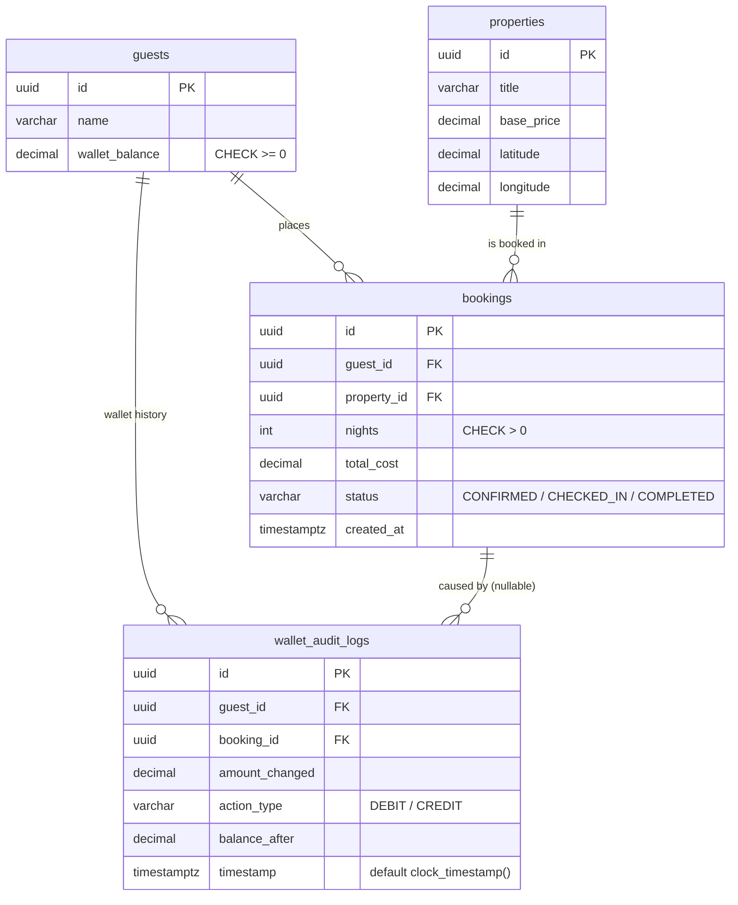

# Relational ERD (current schema)

`relational_erd.png` is the Assignment 1 export and is out of date (it lacks `bookings.nights` and `wallet_audit_logs.booking_id`). This diagram matches `sql/01_schema_ddl.sql`.

